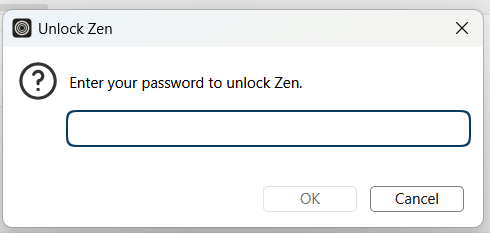
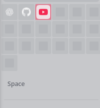

<a id="top"></a>

<div align="center">

# 🦊 Firefox userChromeJS

**Small scripts. Better tabs. More control.**

A collection of browser-chrome customizations for **Firefox** and **Zen Browser** — tab highlighting, memory tools, YouTube helpers, browser locks, and modular CSS.

[](https://www.mozilla.org/firefox/)
[](https://zen-browser.app/)
[](LICENSE)

**[🚀 Install](#install) · [🎨 Appearance](#appearance) · [🧠 Memory](#memory) · [▶️ YouTube](#youtube) · [🔒 Locks](#locks) · [🖌️ CSS](#css) · [⚙️ Preferences](#preferences) · [🛠️ Help](#help)**

</div>

> [!NOTE]
> Install only the components you want. Sections stay visible for easy browsing; use the links above or the table below to jump to a component. Several styles and folder features are specific to Zen Browser.

### Choose a script or style

| Category | Component | Description |
|:--|:--|:--|
| 🎨 Appearance | [**Tab Highlight Plus**](#tab-highlight) | Color tabs, Zen folders, and their contents. |
| 🖱️ Tabs | [**Double Click Duplicate Tab**](#duplicate-tab) | Double-click a tab to duplicate it. |
| 🧹 Memory | [**Smart Firefox Memory Cleaner**](#periodic-memory) | Scheduled cleanup, toolbar controls, and a tab/process memory monitor. |
| 🧠 Memory | [**Extreme Memory Controller — obsolete**](#extreme-memory) | Older inactive-tab suspension and discard experiment. |
| 🕒 Memory | [**Legacy Periodic Memory Cleaner — obsolete**](#legacy-memory) | Original fixed two-minute cleanup script. |
| 🌈 YouTube | [**YTColors26**](#yt-colors) | Color video cards by upload age and dim older cards. |
| ▶️ YouTube | [**YTPlaybackFixer**](#yt-playback) | Attempt playback recovery and preferred-quality selection. |
| 🔒 Locks | [**Password Lock Screen**](#password-lock) | Password overlay with a manual shortcut and startup-lock option. |
| 🔑 Locks | [**Startup Password Lock**](#startup-password) | Native password dialog with three attempts and one check per browser process. |
| 🖌️ CSS | [**Browser appearance**](#browser-css) | Toolbar dots, animated URL bar, compact Essentials, and navigation tweaks. |
| 🧩 CSS | [**Content pages**](#content-css) | Styles for Add-ons Manager, about:config, private browsing, and images. |
| ⚙️ Preferences | [**user.js & prefs cleaner**](#preferences) | Optional profile preferences and a Windows preference-cleanup tool. |

---

<a id="install"></a>

<div align="center">

# 🚀 · Getting started — Requirements & installation

</div>

#### What you need

- Firefox or Zen Browser. Features that use Zen-specific elements require Zen.
- For JavaScript, a working browser-chrome script loader such as [**fx-autoconfig**](https://github.com/MrOtherGuy/fx-autoconfig). Follow its installation instructions for both the program files and profile files.
- Your browser profile: `about:support` → **Profile Folder** → **Open Folder**.

#### Install JavaScript

1. Install and configure your loader. This repository supplies customizations; the loader's installation files come from its own project.
2. Copy the selected `.uc.js` files from [`chrome/JS`](chrome/JS) into your profile's `chrome/JS/` folder when using fx-autoconfig.
3. Keep the companion folders for either YouTube script. Remove older copies of the same script, and choose one memory-cleaner implementation.
4. In `about:support`, select **Clear startup cache** if available, then fully restart the browser.

These are **privileged browser scripts**. Install them through a browser-chrome loader; Tampermonkey and Violentmonkey cannot run them in this context. Compatibility depends on your browser build, loader, and other customizations.

#### Where files go

Paths below are relative to the active browser profile, using fx-autoconfig's default mappings.

| Repository file or folder | Destination in your profile |
|:--|:--|
| Selected files from [`chrome/JS`](chrome/JS) | `chrome/JS/` |
| [`chrome/JS/YTColors26/`](chrome/JS/YTColors26) | `chrome/JS/YTColors26/` — keep the child module inside |
| [`chrome/JS/YTPlaybackFixer/`](chrome/JS/YTPlaybackFixer) | `chrome/JS/YTPlaybackFixer/` — keep the child module inside |
| [`chrome/userChrome.css`](chrome/userChrome.css) | `chrome/userChrome.css` |
| [`chrome/userContent.css`](chrome/userContent.css) | `chrome/userContent.css` |
| [`chrome/CSS/`](chrome/CSS) | `chrome/CSS/` — preserve the `chrome/` and `content/` subfolders |
| Optional [`user.js`](user.js) | `user.js` in the profile root |
| Optional [`prefsCleaner.bat`](prefsCleaner.bat) | Profile root, beside `prefs.js` and `user.js` |

> [!IMPORTANT]
> Each YouTube script needs its `.sys.mjs` child module and a working `chrome://userscripts/content/` mapping to `chrome/JS/`. Installing only the `.uc.js` entry file is insufficient. The legacy memory cleaner has a plain `.js` extension, which fx-autoconfig does not automatically load.

#### Install CSS

1. In `about:config`, set `toolkit.legacyUserProfileCustomizations.stylesheets` to **true**.
2. Copy the desired entry file, `userChrome.css` and/or `userContent.css`, together with the corresponding `CSS/` modules into your profile's `chrome/` folder.
3. If you already have either entry file, **merge its imports** into your existing file. Keep `@import` rules before ordinary style rules.
4. Remove unwanted imports and fully restart the browser.

The normal CSS imports work independently of the JavaScript helpers. The supplied `userChrome.css` enables the Zen appearance modules; review them before using the full entry file in Firefox.

[↑ Back to top](#top)

<a id="appearance"></a>
<a id="tab-highlight"></a>

<div align="center">

# 🎨 · Tab Highlight Plus — Color tabs & Zen folders

</div>


**File:** [`highlightTab.uc.js`](chrome/JS/highlightTab.uc.js) · **Version:** 3.4.2

**What it offers**

- 64 preset colors in a compact **8 × 8** grid.
- **Normal** and **Zen-style** pickers in the same menu; HEX/RGB values supported.
- **Full background** or **Border only** styling.
- Color **only the folder header** or **the folder and its contents**.
- Individual tab color overrides, multi-tab selection, saved colors, and automatic text contrast.

**How to use:** Right-click a tab → **Highlight Tab(s)**; or right-click a Zen folder → **Highlight Folder**. **Alt + left-click** a tab to toggle the quick color.

**Quick customization:** Edit these values at the top of the script:

```js
const FONT_SIZE = '11px';
const QUICK_COLOR = '#C5DE92';
```

Folder inheritance uses Zen-specific internals, so browser updates or sidebar mods can affect it.

[↑ Back to top](#top)

<a id="duplicate-tab"></a>

<div align="center">

# 🖱️ · Double Click Duplicate Tab — Faster tab duplication

</div>

**File:** [`dblclickDuplicateTab.uc.js`](chrome/JS/dblclickDuplicateTab.uc.js) · **Version:** 1.0

**Double-click an existing tab** to duplicate it and switch to the copy.

To duplicate **in the background**, use the alternative `gBrowser.duplicateTab(tab)` line already included in the script instead of assigning `gBrowser.selectedTab`.

[↑ Back to top](#top)

<a id="memory"></a>
<a id="periodic-memory"></a>

<div align="center">

# 🧹 · Smart Firefox Memory Cleaner — Cleanup & process monitoring

</div>

**File:** [`Periodically_clean_Firefox_memory.uc.js`](chrome/JS/Periodically_clean_Firefox_memory.uc.js) · **Version:** 2.6

The updated memory cleaner adds configurable scheduling, a **Memory Cleaner** toolbar button, a tab context menu, cleanup history, and a **Tab Memory Monitor**.

**What it offers**

- Manual memory minimization and automatic cleanup with **5 / 10 / 15 / 30 / 60-minute** intervals.
- Optional idle-only cleanup and a pause during detected audio, Picture-in-Picture, or sharing.
- Coordination between browser windows to avoid overlapping cleanup requests.
- A monitor that groups this window's tabs by process and refreshes every **5 seconds while open**.
- Click a tab in the monitor to select it; optionally include processes with no mapped tabs in the current window.
- Cleanup status, statistics reset, and shortcuts to `about:processes` and `about:memory`.

| Setting | Default |
|:--|:--|
| Automatic cleanup | Enabled |
| Cleanup interval | 15 minutes |
| Startup grace period | 2 minutes |
| Only clean when idle | Off; uses a 30-second idle threshold when enabled |
| Pause during audio / PiP / sharing | Off |
| Include processes without local tabs | Off |

**How to use**

1. Right-click a tab → **Memory Cleaner** to access cleanup and settings.
2. Open **Customize Toolbar…**, find **Memory Cleaner**, and drag it onto a toolbar. The script initially leaves the button in the customization palette.
3. Alternatively, use **Memory Cleaner → Show toolbar button** to place it on the navigation toolbar.
4. Press **Ctrl + Alt + M** to toggle the monitor; **Esc** closes it.

On a fresh installation, the first automatic cleanup can run after the startup grace period. Later runs follow the selected interval and saved attempt time. Idle/media restrictions apply to automatic cleanup; manual cleanup remains available.

> [!NOTE]
> Cleanup history measures **parent-process RSS**. The monitor displays **whole-process memory**; tabs can share a process or span several processes. On Windows, the process values represent commit size. A completed cleanup request does not guarantee reduced RAM usage.

**Customize:** Use the menu for saved options. Advanced timing values are in `CONFIG` near the top of the script. Replace the legacy cleaner when installing this version.

[↑ Back to top](#top)

<a id="extreme-memory"></a>

<div align="center">

# 🧠 · Extreme Memory Controller — Obsolete

</div>

**File:** [`extreme-memory-controller.uc.js`](chrome/JS/extreme-memory-controller.uc.js) · **Version:** 34.3 · **Status:** Obsolete

Older experimental tab management: monitors inactivity, detects audio/Picture-in-Picture, attempts suspension, discards eligible tabs, and requests memory cleanup.

| Setting | Default |
|:--|--:|
| Suspend inactive regular tabs | 10 min |
| Discard inactive regular tabs | 15 min |
| Discard inactive pinned tabs | 25 min |
| Memory cleanup | Every 30 min |

**Customize:** `IDLE_SUSPEND`, `IDLE_DISCARD`, `PINNED_DISCARD`, and `CLEAN_MEMORY_PERIOD` near the top of the file.

> [!CAUTION]
> This script can interrupt background activity and unload tabs, **including pinned tabs**. Unsaved work may be lost. Its suspension API is browser-version-dependent. For cleanup controls and memory monitoring, see [Smart Firefox Memory Cleaner](#periodic-memory).

[↑ Back to top](#top)

<a id="legacy-memory"></a>

<div align="center">

# 🕒 · Legacy Periodic Memory Cleaner — Obsolete

</div>

**File:** [`Periodically_clean_Firefox_memory.js`](chrome/JS/Periodically_clean_Firefox_memory.js) · **Status:** Obsolete

The original script requests garbage collection and memory minimization every **2 minutes**. The source credits [garywill/firefoxtaskmonitor](https://github.com/garywill/firefoxtaskmonitor) and notes testing with Firefox 102 and xiaoxiaoflood's loader.

**Customize:** Change `cleanMemory_period` in the source. Its plain `.js` filename needs explicit loader support or a suitable `.uc.js` filename under fx-autoconfig. Keep it disabled when using the newer `.uc.js` cleaner.

[↑ Back to top](#top)

<a id="youtube"></a>
<a id="yt-colors"></a>

<div align="center">

# 🌈 · YTColors26 — YouTube video age borders

</div>

<div align="center">


</div>

**Files:** [`YTColors26.uc.js`](chrome/JS/YTColors26.uc.js) + [`YTColors26Child.sys.mjs`](chrome/JS/YTColors26/YTColors26Child.sys.mjs) · **Child module:** v7.1

- Colors video cards by upload-age unit, with separate live/upcoming categories.
- Dims older video cards and can mark the last-seen subscriptions video.
- Uses visibility-based processing and reacts to cards added during infinite scrolling.

| Detected age/category | Default color |
|:--|:--|
| Seconds, minutes, hours | `#16a978` |
| Days | `#6cd1f0` |
| Weeks | `#e9dbe9` |
| Months | `#806697` |
| Years | `#4e4c49` |
| Live | `#9e4733` |
| Upcoming | `#f5e4d2` |

**Customize:** Edit `COLORS` and `OLD_OPACITY` in the **child module**. The current old-card opacity is `0.4`. Detection relies on supported card layouts and English age labels; localized metadata can affect classification.

[↑ Back to top](#top)

<a id="yt-playback"></a>

<div align="center">

# ▶️ · YTPlaybackFixer — Playback recovery & quality control

</div>

<div align="center">


</div>

**Files:** [`YTPlaybackFixer.uc.js`](chrome/JS/YTPlaybackFixer.uc.js) + [`YTPlaybackFixerChild.sys.mjs`](chrome/JS/YTPlaybackFixer/YTPlaybackFixerChild.sys.mjs) · **Actor:** V5

- Tries to recover from playback errors, stalls, and buffering problems on supported `www.youtube.com` watch/live pages.
- Adds playback status and quality controls near supported video titles.
- Offers quality requests through `hd1080`, `hd1440`, `hd2160`, and `highres`, plus lower resolutions, `auto`, and `Disable`.
- Saves the preferred selection in YouTube's local storage; the initial selection is **Disable**.

> [!WARNING]
> YouTube can override quality requests. **Selecting 4K does not guarantee 4K playback.** Confirm using **Settings → Quality** and **Stats for Nerds**. Recovery may restart playback.

The child module retains the MIT license and attribution to **YouTube – Playback Fixer** by brizzle.

[↑ Back to top](#top)

<a id="locks"></a>
<a id="password-lock"></a>

<div align="center">

# 🔒 · Password Lock Screen — Manual & startup overlay

</div>

**File:** [`PwdLockScreen.uc.js`](chrome/JS/PwdLockScreen.uc.js)

Adds a password dialog over the current browser window and stores the lock/startup options in profile preferences.

- Press **Ctrl + L** to request a lock through the script's browser-window key handler.
- Enter the password and click **Unlock**, or press **Enter**.
- During a manual lock, enable **Locked every time it starts** to request the overlay on subsequent launches/windows where the script runs.
- The script uses `browser.lock.isLocked` and `browser.lock.alwaysLock` to retain state.

**Before enabling:** Change `CUSTOM_PASSWORD` at the top of the file. The included value is **`123456`**. The chosen shortcut overlaps Firefox/Zen's usual **focus address bar** shortcut; change the key handler if needed.

This is a convenience overlay. The password is stored in the script as plain text, and the overlay provides no profile encryption or operating-system access control.

[↑ Back to top](#top)

<a id="startup-password"></a>

<div align="center">

# 🔑 · Startup Password Lock — Native password dialog

</div>

<div align="center">



</div>

**File:** [`StartupPwdLock.uc.js`](chrome/JS/StartupPwdLock.uc.js) · **Version:** 2.0.1

Shows a native **Unlock Zen** dialog with English text and a focused password field.

- Allows **3 incorrect non-empty submissions** by default; the dialog displays the remaining attempts.
- Disables **OK** while the field is empty. Pressing **Enter** on an empty field keeps the dialog open and focuses the field without consuming an attempt.
- Checks the password **once per browser process**, with a guard against duplicate script copies. Background-task mode is skipped.
- Accepts the correct password to continue; startup hooks handle the prompt when the script is loaded early, and it prompts immediately if startup has already finished.

**Before enabling:** Change `CUSTOM_PASSWORD` at the top of the file. The included value is **`123456`**. Change `MAX_ATTEMPTS` to adjust the attempt limit.

> [!CAUTION]
> Canceling the dialog, exhausting the attempt limit, or encountering a script error calls **force quit for the whole browser**. The password is stored in the script as plain text; this is a convenience lock, with no profile encryption or operating-system access control.

Choose the lock method that matches your workflow. Enabling both lock scripts can produce multiple password prompts.

[↑ Back to top](#top)

<a id="css"></a>
<a id="browser-css"></a>

<div align="center">

# 🖌️ · Browser CSS — Minimal Zen appearance

</div>

**Entry file:** [`chrome/userChrome.css`](chrome/userChrome.css) · **Modules:** [`chrome/CSS/chrome/`](chrome/CSS/chrome)

<div align="center">



<p><strong>Compact Essentials</strong> · Expanded Zen sidebar</p>

</div>

The entry file imports the six modules below. Comment out an import to disable that customization, then restart.

| Stylesheet | Current behavior | Main customization |
|:--|:--|:--|
| [`hide_window_controls.css`](chrome/CSS/chrome/hide_window_controls.css) | Hides the window's minimize/maximize/close button boxes. | Remove the import to restore native controls. |
| [`minimal_toolbarbuttons_zen.css`](chrome/CSS/chrome/minimal_toolbarbuttons_zen.css) · v19 | Shows neutral dots in place of supported idle toolbar icons, including pinned extensions; reveals individual icons on hover/focus. | `--uc-mtb-dot-size`, `--uc-mtb-dot-color`, animation timing. |
| [`ghost_urlbar.css`](chrome/CSS/chrome/ghost_urlbar.css) · v14 | Shows animated pulse dots while the URL bar is idle; reveals its native input and controls on hover/focus/open states. | `--zdp-*` colors and timing values. |
| [`zen_essentials_compactl.css`](chrome/CSS/chrome/zen_essentials_compactl.css) · v2.3 | Arranges Essentials in **6 columns** when expanded and **2 columns** when collapsed. | `--zec-columns`, `--zec-gap`, `--zec-icon`, `--zec-extra-inline`. |
| [`no_scrollbar_sidebar_zen.css`](chrome/CSS/chrome/no_scrollbar_sidebar_zen.css) | Hides the sidebar scrollbar using one of two selector branches. | `theme.nosidebarscrollbar.before125b` selects the alternate branch. |
| [`zen_back_forward.css`](chrome/CSS/chrome/zen_back_forward.css) | Hides disabled Back/Forward buttons outside toolbar customization. | Remove the import to keep both buttons visible. |

The toolbar and URL-bar styles include light/dark colors and reduced-motion rules. Their selectors depend on the current browser interface and can conflict with overlapping Zen Mods.

**Note:** The entry file still contains older descriptive comments for some modules. The versions and behavior above follow the imported stylesheets, including the current **six-column** Essentials layout.

[↑ Back to top](#top)

<a id="content-css"></a>

<div align="center">

# 🧩 · Content CSS — Built-in pages & image viewing

</div>

**Entry file:** [`chrome/userContent.css`](chrome/userContent.css) · **Modules:** [`chrome/CSS/content/`](chrome/CSS/content)

| Stylesheet | Target | What it changes |
|:--|:--|:--|
| [`about-addons.css`](chrome/CSS/content/about-addons.css) · v4 | Add-ons Manager | Store-inspired light/dark appearance, compact navigation rail, responsive extension-card grid, and separate Details-page sizing. |
| [`about-config.css`](chrome/CSS/content/about-config.css) | `about:config` | Compact preference rows, rounded controls, and an embedded patterned background. |
| [`private-browsing.css`](chrome/CSS/content/private-browsing.css) | `about:privatebrowsing` | Custom background/logo references and private-search styling. |
| [`image-viewer.css`](chrome/CSS/content/image-viewer.css) | Standalone image documents | Dark surrounding background and a checkerboard for transparent images. |

**Custom resources:** The private-browsing style references these files through fx-autoconfig's `chrome://userchrome/content/` resource mapping:

- `chrome/resources/wallpaper/wallpaper.png`
- `chrome/resources/icons/firefox-private.svg`
- `chrome/resources/icons/firefox-private-light.svg`

Those assets are **not included** in this repository. Supply your own files, change the URLs, or remove the corresponding rules. Some content styles also reference external theme variables such as `--firefoxcss-main-bg-color`; define them in your theme if you want those declarations to apply.

[↑ Back to top](#top)

<a id="preferences"></a>

<div align="center">

# ⚙️ · Profile preferences — Optional user.js & cleanup

</div>

**Files:** [`user.js`](user.js) + [`prefsCleaner.bat`](prefsCleaner.bat)

The optional `user.js` contains Zen interface, scrolling, network, memory, media, and privacy preferences. Review it before placing it in the **profile root**; individual script installation does not require this complete preset.

- The bundled DNS configuration points to a specific **NextDNS Ultralow profile** and sets `network.trr.mode` to **3**. Replace the endpoint with your own DNS configuration before adopting it.
- The preset changes automatic/background update behavior; review the update settings and maintain browser updates yourself where automatic updating is disabled.
- A `user_pref(...)` line is active even if its section heading says “reference only.” A commented line such as `// user_pref(...)` is inactive.
- Removing a line from `user.js` leaves its existing value in `prefs.js`; reset the preference separately if you want the browser default back.

**Windows helper:** `prefsCleaner.bat` v2.8 by claustromaniac backs up `prefs.js` and removes keys listed in `user.js`, including keys found in commented preference lines. Active `user.js` values are applied again at the next startup. Close **all Firefox/Zen processes** before running it from the profile root; its built-in process check only looks for `firefox.exe`.

[↑ Back to top](#top)

<a id="help"></a>

<div align="center">

# 🛠️ · Troubleshooting — Common fixes

</div>

| Problem | First thing to check |
|:--|:--|
| Script/menu does not appear | Loader configuration, filename, correct profile/path, startup cache, and duplicate script copies. |
| Memory Cleaner button is missing | Right-click a tab → **Memory Cleaner → Show toolbar button**, or find **Memory Cleaner** in **Customize Toolbar…**. Use **Show cleanup status** to inspect toolbar errors. |
| Memory Cleaner menu options are unavailable | Confirm the new `.uc.js` file loaded and initialized; remove stale copies, restart, and inspect `[SmartMemoryCleaner]` errors in Browser Console. |
| Toolbar icons appear as dots | This is the minimal-toolbar stylesheet's idle appearance. Hover/focus the button to reveal its icon, or disable that CSS import. |
| Monitor memory differs from a tab's expected usage | The monitor reports whole processes, which tabs may share or span. Windows process values are commit size. |
| CSS does not apply | Check `toolkit.legacyUserProfileCustomizations.stylesheets`, filename extensions, relative import paths, and restart the browser. |
| Window controls or disabled navigation buttons disappear | Review the `hide_window_controls.css` and `zen_back_forward.css` imports. |
| Private-browsing wallpaper/logo is missing | Supply the referenced resource files or change the CSS URLs. |
| Agent/author stylesheet helper reports a missing file | Supply its matching `chrome/resources/userChrome.ag.css` / `userChrome.au.css` file, or disable the optional helper. |
| YouTube actor fails | Check the companion `.sys.mjs` path and `chrome://userscripts/content/` mapping. |
| Zen folder children stay uncolored | **Highlight Folder → Apply folder color to → Folder + all tabs & subfolders**. |
| Colors disappear on restart | Check restored tab sessions and unchanged Zen folder IDs. |
| Playback quality does not change | Verify actual quality in **Stats for Nerds**; YouTube may override requests. |
| Browser quits after the startup password dialog | v2.0.1 force-quits on cancel, after the configured number of incorrect submissions, or on a script error. Check `CUSTOM_PASSWORD` and `MAX_ATTEMPTS`. |
| Tabs reload unexpectedly | Check the obsolete memory controller and `browser.tabs.unloadOnLowMemory` in the optional preference preset. |

**Browser Console:** `Ctrl + Shift + J` — include relevant errors, your Firefox/Zen version, loader, and component name when [reporting an issue](https://github.com/R3mia/Firefox-userChromejs/issues).

[↑ Back to top](#top)

<div align="center">

# 📜 · License, credits & contributions

</div>

This repository includes an [MPL-2.0 license](LICENSE). Individual files can also include third-party copyright and license notices; **preserve those notices** when reusing code.

**Acknowledgements:** [fx-autoconfig](https://github.com/MrOtherGuy/fx-autoconfig) · [MrOtherGuy / firefox-csshacks](https://github.com/MrOtherGuy/firefox-csshacks) · [Ulf3000 / Firefox Highlight Tabs](https://github.com/Ulf3000/Firefox-Highlight-Tabs) · [garywill / firefoxtaskmonitor](https://github.com/garywill/firefoxtaskmonitor) · brizzle (YouTube Playback Fixer upstream) · claustromaniac (prefs.js cleaner).

Contributions and compatibility reports are welcome: [**Open an issue**](https://github.com/R3mia/Firefox-userChromejs/issues) or submit a pull request. Include your browser version, loader, affected component, and reproduction steps.

---

<div align="center">

**[↑ Back to top](#top) · [Browse scripts](chrome/JS) · [Browse CSS](chrome/CSS) · [Report an issue](https://github.com/R3mia/Firefox-userChromejs/issues)**

<sub>Community-maintained experiments · Not affiliated with Mozilla, Zen Browser, or YouTube</sub>

</div>
